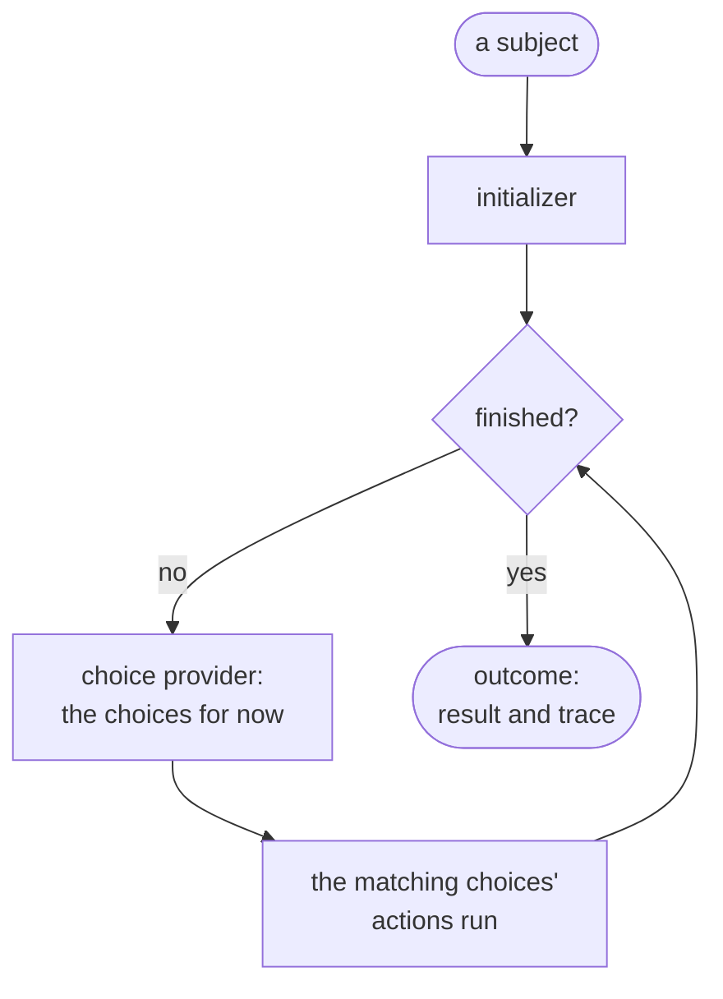

# BelayKit

BelayKit builds the loop around a focused agent: an agent with one goal, given one thing to work on, that runs a
bounded number of steps and stops with an outcome. You supply the parts that make it your agent (how it starts, the
choices it can make, when it's done); BelayKit runs them, step by step, and every run ends with a result and a trace of
what happened, even when something fails.

Decisions can be written in code, or as a **rulebook**: a YAML file of rules with CEL conditions, checked against
your code before it runs.



```bash
npm install @belaykit/core
npm install @belaykit/rulebook   # for rulebooks
```

## A one-minute agent

```js run
import { Agent, always } from '@belaykit/core';

const agent = new Agent({
  initializer: (subject) => ({ text: subject, labels: [] }),
  choiceProvider: async () => ({
    name: 'label',
    mode: 'first',
    choices: [
      { name: 'urgent', criteria: async (ws) => ({ matched: ws.text.includes('down') }), actions: [async (ws) => { ws.labels.push('urgent'); }] },
      { name: 'routine', criteria: always, actions: [async (ws) => { ws.labels.push('routine'); }] },
    ],
  }),
  finishChecker: (ws) => ws.labels.length > 0,
  finalizer: (ws) => ws.labels,
});

const outcome = await agent.run('the server is down');
console.log(outcome.status, outcome.result);
```

```text output
completed [ 'urgent' ]
```

## Learn more

- [Getting started](documentation/getting-started.md): a first agent in code and with a rulebook, then a complete example
  agent that extracts and files a document's snippets with a model.
- [Concepts](documentation/concepts.md): the loop, choices, outcomes, the trace and the options.
- [Rulebooks](documentation/rulebooks.md): the rulebook format, macros, the registry, checks and fixtures, and a
  rulebook used on its own as a decision function (`rules.decide`).
- API reference: [`@belaykit/core`](documentation/api/core.md), [`@belaykit/rulebook`](documentation/api/rulebook.md).
- [`examples/doc-processor`](examples/doc-processor): the example agent, written with and without a rulebook.
- [Upgrading](documentation/upgrading.md) from an earlier version, and the [changelog](CHANGELOG.md).

## Packages

| Package | What it is |
| --- | --- |
| [`@belaykit/core`](packages/core) | The loop: `Agent`, `chain`, `always`. No dependencies. |
| [`@belaykit/rulebook`](packages/rulebook) | Rulebooks: YAML + CEL rules checked against your code, as a choice provider. |

## Status

0.3. The API may change before 1.0, but changes will be deliberate, and each is listed in the
[changelog](CHANGELOG.md), with what to do in [Upgrading](documentation/upgrading.md).

## License

MIT
