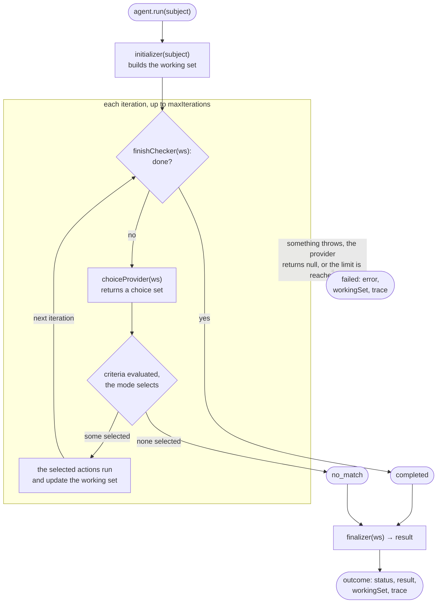
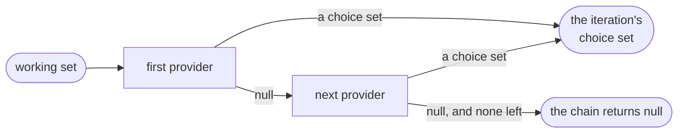

# Concepts

BelayKit builds the loop around a focused agent: an agent with one goal, given one thing to work on, that runs a
bounded number of steps and then stops with an outcome. This page explains the parts you supply, what BelayKit does
with them, and what comes back. [Getting started](getting-started.md) builds a real agent with them; the
[API reference](api/core.md) lists every export.

## The loop

You make an agent once and run it on each **subject**: the thing one run is about, such as a document or a request.
Each run goes like this:

1. The **initializer** builds a **working set** from the subject. The working set is the run's state, and it's
   yours: the loop never writes to it, only actions do. (A [rulebook](rulebooks.md) supplies actions of its own,
   which fill the keys it gathers and its `gathered` list.)
2. The **finish checker** looks at the working set. If it says the run is done, the run ends `completed`.
3. Otherwise the **choice provider** looks at the working set and returns a **choice set**: the choices that make
   sense now.
4. BelayKit evaluates each choice's **criteria** against the working set, selects the matching ones according to the
   set's **mode**, and runs their **actions**, which update the working set.
5. Back to step 2.

The run ends `no_match` if a choice set selects nothing, and `failed` if something throws. When it ends, the
**finalizer** turns the final working set into the run's **result**, and you get an **outcome** with the result, the
working set and a **trace** of every iteration.



```js run
import { Agent, always } from '@belaykit/core';

const agent = new Agent({
  initializer: (subject) => ({ text: subject, labels: [] }),
  choiceProvider: async () => ({
    name: 'label',
    mode: 'first',
    choices: [
      { name: 'urgent', criteria: async (ws) => ({ matched: ws.text.includes('down') }), actions: [async (ws) => { ws.labels.push('urgent'); }] },
      { name: 'routine', criteria: always, actions: [async (ws) => { ws.labels.push('routine'); }] },
    ],
  }),
  finishChecker: (ws) => ws.labels.length > 0,
  finalizer: (ws) => ws.labels,
});

const outcome = await agent.run('the server is down');
console.log(outcome.status, outcome.result, outcome.trace.map(({ set, fired }) => `${set}: ${fired}`));
```

```text output
completed [ 'urgent' ] [ 'label: urgent' ]
```

## The agent and its essentials

An agent is `new Agent(essentials, options)`. The **essentials** are what make it this agent:

| Essential | What it is |
| --- | --- |
| `initializer` | `(subject) => workingSet`, sync or async. Builds the working set for one run. |
| `choiceProvider` | `async (workingSet) => choiceSet` (or `null`). Called on every iteration. |
| `finishChecker` | `(workingSet) => boolean`, sync or async. Checked before every provider call. |
| `finalizer` | Optional. `(workingSet) => result`, sync or async. Without one, the result is the working set. |

The **options** are incidental; they're described in their own section [below](#options-incidental). `new Agent`
throws a `TypeError` for a key either argument doesn't take, naming the argument a misplaced key belongs in, and for
a part of the wrong kind: a missing essential, a finalizer or tracer that isn't a function (a tracer may also be
`false`), or a `maxIterations` that isn't a positive integer. So a mistake shows up when you make the agent, not as
every run failing, or quietly using a default:

```js run
import { Agent } from '@belaykit/core';

const attempt = (essentials, options) => {
  try {
    new Agent(essentials, options);
  } catch (error) {
    console.log(error.message);
  }
};

const initializer = (subject) => ({ subject });
const choiceProvider = async () => null;
attempt({ initializer, choiceProvider });
attempt({ initializer, choiceProvider, finishChecker: () => true }, { maxIterations: process.env.MAX_STEPS ?? '10' });
attempt({ initializer, choiceProvider, finishChecker: () => true, maxIterations: 10 });
```

```text output
new Agent: finishChecker must be a function
new Agent: maxIterations must be a positive integer, got "10"
new Agent: unknown essential "maxIterations" (it is an option: pass it in the second argument)
```

One agent runs many subjects: `run` is called once per subject, and each run gets its own working set.

## Choice sets, choices and modes

A **choice** has a `name`, **criteria** and **actions**, and optionally a `why` that the trace carries beside its
name:

- **Criteria** answer "does this choice apply now?": `async (workingSet) => ({ matched, data?, detail? })`. They may
  do I/O (a lookup, a model call), but by convention they don't change the working set. `data` is handed to the
  choice's actions; `detail` is a small note recorded in the trace.
- **Actions** do the work: `async (workingSet, match) => void`. They are the only writers of the working set, and
  they run in order.

A **choice set** is `{ name?, mode, ... }`. Its **mode** says how matching choices are selected:

| Mode | Shape | Selects |
| --- | --- | --- |
| `first` | `{ choices }` | the first choice whose criteria match |
| `all` | `{ choices }` | every choice whose criteria match |
| `first_else_all` | `{ first, all }` | the first match in `first`; only if there's none, every match in `all` |
| `first_then_all` | `{ first, all }` | the first match in `first`, and every match in `all` |

Every mode selects before any action runs, so every choice in an iteration sees the same working set. Choice names
must be unique within a set (across both groups), because names are how the trace identifies choices.

## Providers, and providers that pass

A **choice provider** returns the choice set that makes sense for the working set as it is now. It may return a
different set each time, which is how an agent moves through steps: read, then classify, then review.

A provider may also return `null`: "nothing to offer". On its own, an agent's provider that returns `null` ends the
run `failed`. Inside `chain([...providers])`, `null` hands the iteration to the next provider; the first that returns
a set claims it, and the chain itself returns `null` when none does. That's how a rulebook, which only knows some
situations, hands the rest to code:



```js run
import { Agent, always, chain } from '@belaykit/core';

const known = async (ws) => (ws.text.startsWith('#') ? { name: 'heading', mode: 'first', choices: [{ name: 'skip', criteria: always, actions: [async (w) => { w.kind = 'heading'; }] }] } : null);
const fallback = async () => ({ name: 'text', mode: 'first', choices: [{ name: 'keep', criteria: always, actions: [async (w) => { w.kind = 'text'; }] }] });

const agent = new Agent({
  initializer: (line) => ({ text: line, kind: null }),
  choiceProvider: chain([known, fallback]),
  finishChecker: (ws) => ws.kind !== null,
  finalizer: (ws) => ws.kind,
});

console.log((await agent.run('# Notes')).result, (await agent.run('buy film')).result);
```

```text output
heading text
```

## Outcomes and best effort

`run` never rejects. Every run resolves with an **outcome**:

- `{ status: 'completed', result, workingSet, trace }`: the finish checker said done.
- `{ status: 'no_match', result, workingSet, trace }`: a choice set selected nothing, so the run couldn't go on.
- `{ status: 'failed', error, workingSet, trace }`: something threw (a criterion, an action, the provider, a part of
  the agent such as the finalizer), the provider returned no set, or the iteration limit was reached.
  `error.message` names the source, such as `judge/lookup criteria failed: …`, and `error.trace` carries the trace. A
  failed run has no `result`, because its working set may be half-updated.

```js run
import { Agent } from '@belaykit/core';

const agent = new Agent({
  initializer: (question) => ({ question, answer: null }),
  choiceProvider: async () => ({
    name: 'judge',
    mode: 'first',
    choices: [{ name: 'lookup', criteria: async () => { throw new Error('search unavailable'); }, actions: [] }],
  }),
  finishChecker: (ws) => ws.answer !== null,
});

const outcome = await agent.run('which lens?');
console.log(outcome.status, 'result' in outcome, outcome.error.message, outcome.error.trace.length);
```

```text output
failed false judge/lookup criteria failed: search unavailable 1
```

Within one run, the loop stops at the first error rather than skipping a failed action: later iterations would see a
half-updated working set. Deciding what can fail on its own (one item of many, one day of a week) is your agent's
domain knowledge, so isolation is the agent's job: catch per item in an action and record the failure, or run one
subject per item and record failed outcomes. [Getting started](getting-started.md) shows the first.

## The trace

Every iteration leaves a **trace entry**, returned beside the working set, never stored in it:

```js fragment
{ iteration, set, mode, fired, durationMs,
  evaluated: [{ choice, matched, why?, detail? } | { choice, error, why? }],  // every criterion that ran, in order
  unevaluated: [name],                                                     // choices whose criteria never ran
  executed: [{ choice, action }],                                          // each action that completed, by index
  failed: true }                                                           // only on the iteration that failed
```

An iteration that fails still leaves its partial entry, so a failed run shows where it stopped. A criterion's
`detail` is recorded; its `data` never is.

## Options (incidental)

The options are the second argument to `new Agent`. Most agents need neither.

- **`tracer`** decides what to keep of each iteration's trace entry: `(entry, { matches }) => kept`, where `matches`
  holds every criterion result of that iteration, `data` included. What it returns is kept; `null` or `undefined`
  (a tracer with no `return`) keeps nothing for that iteration; `tracer: false` keeps no trace at all. By default every entry is kept as is. (This `tracer` is
  BelayKit's own hook for its trace; it isn't OpenTelemetry's `tracer`, though a tracer could forward entries to one.)
- **`maxIterations`** (default 25) guards against a run that never finishes: a run that hasn't finished after that
  many iterations ends `failed` with an `IterationLimitError`. It's fixed when you make the agent, so set it for the largest subject you expect; an agent
  that takes two iterations per item needs room for all of them.

```js run
import { Agent, always } from '@belaykit/core';

const agent = new Agent({
  initializer: () => ({ count: 0 }),
  choiceProvider: async () => ({ name: 'count', mode: 'first', choices: [{ name: 'step', criteria: always, actions: [async (ws) => { ws.count += 1; }] }] }),
  finishChecker: (ws) => ws.count === 3,
}, {
  tracer: (entry) => entry.iteration,
  maxIterations: 10,
});

console.log((await agent.run()).trace);
```

```text output
[ 1, 2, 3 ]
```

## Rulebooks

A **rulebook** writes an agent's decisions as text: a YAML file of **sections** and **rules** with CEL conditions,
checked when it loads against your agent's **registry** of producers, actions and functions. A loaded `Rulebook`
gives you a choice provider, so it fits the loop like any other provider and chains with code. See
[Rulebooks](rulebooks.md).

## Glossary

| Term | Meaning |
| --- | --- |
| Agent | A focused, transient worker, made with `new Agent(essentials, options)` and run once per subject. |
| Subject | What one run is about: the value passed to `run`. |
| Essentials | What makes an agent that agent: its initializer, choice provider, finish checker and optional finalizer. |
| Options | The incidentals: the tracer and `maxIterations`. |
| Working set | A run's state. Built by the initializer, written only by actions. |
| Choice provider | Given the working set, the choice set that makes sense now, or `null` for nothing to offer. |
| Choice set | The choices for one iteration and the mode that selects among them. |
| Choice | Criteria and the actions to run when they match. |
| Criteria | A choice's check: `{ matched, data?, detail? }`. |
| Action | A choice's work; the only thing that writes the working set. |
| Finish checker | Says whether the run is done; checked before every provider call. |
| Finalizer | Turns the final working set into the result. |
| Outcome | How a run ended: `status`, then `result` or `error`, the working set and the trace. |
| Trace | One entry per iteration: what was evaluated, what fired, what ran. |
| Tracer | Decides what to keep of each trace entry. |
| Rulebook | A YAML + CEL file of sections and rules that provides choices; see [Rulebooks](rulebooks.md). |
| Strategy | Everything an agent's author supplies: the essentials, any rulebooks and their registry, any code providers, and the options. BelayKit supplies the loop that runs it. |
