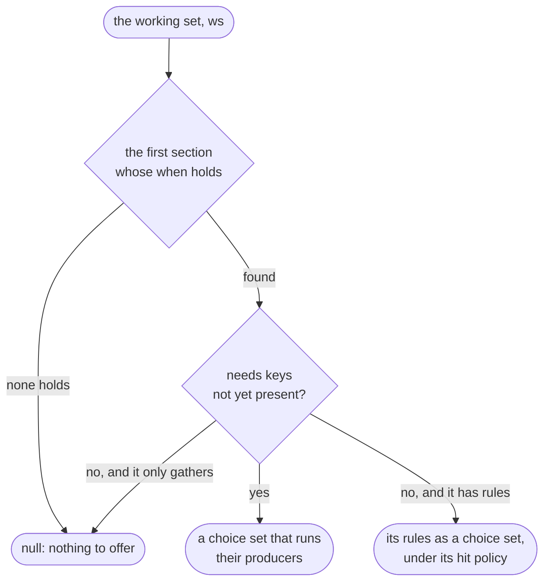

# Rulebooks

A **rulebook** writes an agent's decisions as text: a YAML file of **sections** and **rules**, with conditions in
[CEL](https://cel.dev) (the Common Expression Language: small, side-effect-free expressions). It's checked when it
loads against your agent's **registry**, the code it may name, and a loaded `Rulebook` gives you a choice provider for
`@belaykit/core`. This page is the reference for the format and the package; [Getting started](getting-started.md)
shows one in use. Coming from an earlier version? [Upgrading](upgrading.md) lists what changed in each release and
what to do.

```bash
npm install @belaykit/core @belaykit/rulebook
```

## A rulebook

```yaml
# triage.rules.yaml
version: 1
sections:
  - name: gather
    when: '!has(ws.classification)'                 # until it is gathered
    needs: { classification: classify_item }        # a producer fills ws.classification
  - name: decide
    when: ws.routing == null
    hitPolicy: FIRST                                 # FIRST: the first rule that holds; ALL: every rule that holds
    rules:
      - id: urgent
        when: ws.classification.urgent == true
        then: { action: settle, routing: escalate }  # `routing` is a param for the action
        why: urgent items go to a person
      - id: fallback
        when: "true"
        then: { action: settle, routing: hold }
```

| Key | Where | Meaning |
| --- | --- | --- |
| `version` | top | Always `1`. |
| `imports` | top | Optional. Macro files whose macros this rulebook calls, relative to it; one or more, no path twice. See [Macros](#macros). |
| `hitPolicyDefault` | top | `FIRST` or `ALL`, for sections that don't set `hitPolicy`. Default `FIRST`. |
| `outputs` | top | Optional. The working-set keys `rules.decide` returns. See [below](#deciding-with-a-rulebook). |
| `evidence` | top | Optional, with `outputs`. Other working-set keys every decision shows, as the run left them. See [below](#deciding-with-a-rulebook). |
| `sections` | top | The sections, in order. |
| `name` | section | Names the iteration in the trace. |
| `when` | section | CEL: when this section applies. |
| `needs` | section | `{ key: producer }`: working-set keys this section gathers before its rules run. |
| `hitPolicy` | section | `FIRST` (the first rule that holds) or `ALL` (every rule that holds). |
| `exhaustive` | section | Optional, `false` only: this `FIRST` section needs no catch-all rule. See [below](#when-no-rule-holds). |
| `rules` | section | The rules. A section may have none and only gather. |
| `id` | rule | Optional. Names the rule in the trace and errors; default `<section>#<n>`, counting from 1. |
| `selectFirst` | rule | Optional. `{ name: <CEL list> }`: act on one item of a list. See [below](#selectfirst). |
| `when` | rule | CEL: when this rule holds. |
| `then` | rule | `{ action: <registered action>, ...params }`: the action to run, and literal params for it ([templated](#templated-params) where the action allows). |
| `why` | rule | Optional. Carried into the trace beside the rule's name. |

Section names, rule ids and `selectFirst` binding names match `^[a-z][a-z0-9_]*$`: a lowercase letter, then lowercase
letters, digits and underscores. So a rule is `type_next`, not `type-next` as a choice in code might be.

## How a rulebook decides

On each iteration the rulebook's provider looks at the working set (`ws` in CEL):

1. It takes the **first section whose `when` holds**. Later sections aren't tried in that iteration, even if the
   first one has nothing to do.
2. If that section has `needs` keys not yet **gathered** (not present in the working set), it returns a choice set
   that runs their producers (`gather <key>` in the trace).
3. Otherwise it returns the section's rules as a choice set, under its hit policy: each rule is a choice named by its
   `id`, whose criteria check its action's [guard](#guarded-actions), if it has one, then evaluate its `when`, and
   whose action is the registered action in `then`.
4. If no section's `when` holds, or the claiming section only gathers and its needs are met, it returns `null`:
   nothing to offer. As an agent's only provider, that ends the run `failed`; in a `chain`, the next provider takes
   the iteration.



So a gather-only section's `when` should turn false once its work is done, or it keeps claiming the working set:
write it `!has(ws.<key>)`.

### When no rule holds

A section that claims the working set and has rules returns them as a choice set, so if none of them holds, the run
ends `no_match`, even in a `chain`: the next provider isn't asked, since this one had something to offer. So a `FIRST`
section says what happens then. Either its last rule always holds, doing what you mean by "none of the above": its
`when` is `"true"`, it has no `selectFirst` (which can fail on an empty list), and its action has no
[guard](#guarded-actions) (which can fail too). Or the section says `exhaustive: false`: it needs no catch-all,
because its `when` already ensures that some rule holds, or because a no-match should end the run. Otherwise it is a
load error. `ALL` and gather-only sections are exempt.

```js run
import { Rulebook } from '@belaykit/rulebook';

const registry = { producers: {}, actions: { settle: { writes: ['routing'], run: async () => {} } }, initialKeys: ['item', 'routing'] };
console.log(Rulebook.check(`
version: 1
sections:
  - name: decide
    when: ws.routing == null
    rules:
      - when: ws.item == "urgent"
        then: { action: settle }
`, registry).join('\n'));
```

```text output
section "decide": a FIRST section must end in a rule with when: "true" (without selectFirst), or say exhaustive: false
```

## The working set and `needs` keys

`rules.initialize(initial)` builds the working set: a copy of your initial keys, nothing added. A `needs` key is
**gathered when it is present** (there, and not holding `undefined`, as CEL's `has()` reads it): until then it is
absent, and when its section gathers it, the producer's return value becomes its value. Whatever puts the key there
gathers it: an action that writes a `needs` key before its section runs has supplied it, and the producer doesn't run. A producer may return `null` ("looked, found nothing"); the key is present, so it counts as
gathered. A producer that returns `undefined` (a missing `return`, say) fails the run, since the key would read as
absent and be gathered again forever.

So a rule asks whether a key has been gathered with `has(ws.<key>)`, and whether it was found with
`has(ws.<key>) && ws.<key> != null` (or `belaykit.present(ws, "<key>")`). `ws.<key> == null` on a key not yet gathered
fails the run (`No such key`), rather than reading as "not yet". An initial working set that already holds a `needs`
key, `null` included, is refused (`initialize` throws), since that key would count as gathered and its producer
would never run. That check is `initialize`'s: a working set your initializer builds without it is taken as it is.

Everything else in the working set is yours to initialize and declare: initial keys in the registry's `initialKeys`,
keys an action writes in its `writes`. BelayKit adds no field of its own (there is no `ws.gathered` since 0.2) and
assumes no particular field: your finish checker decides when the run is done.

A gathered key stays gathered while it is present. To have it produced again (a code check that rejects a model's
answer, say), an action calls `rules.regather(ws, key)`: the key is removed, so its section gathers it again. A key
the rulebook doesn't declare throws a `TypeError`, which ends the run `failed`, naming the key.

## Conditions in CEL

Every `when` is a CEL expression over `ws`, and it must be a boolean. One whose type is known when the rulebook loads
(a string, a number, a list) is refused then; one whose type is only known at run time (a bare `ws.flag`) fails the run
if it evaluates to anything but `true` or `false`. It's never read as "no match".

`x.y` on a map without key `y` is an error, not `null`: guard with `has(x.y)` when a field may be missing. But
`has(x.y)` is true when `y` holds `null`, so a rule that goes on to read `x.y.z` still fails there. Guard a value
that may be missing *or* `null` with `has(x.y) && x.y != null`, or, for a path of any depth, with BelayKit's helper
`belaykit.present(x, "y.z")` ([below](#belaykits-helpers)).

**Keys and fields are checked when the rulebook loads.** `ws.x` (or `ws["x"]`) must be a known key: one in
`initialKeys`, a section's `needs`, or a producer's or action's `writes`. The fields below a key are checked against
the key's **shape** in the registry, at any depth ([below](#shapes)). A field read where no shape says what it is
(a key without a shape, an object the shape leaves open) is checked only when the rule runs: a missing one fails the
run, never a silent `no_match`.

**Functions.** A rulebook may call CEL's built-in functions and CEL macros, as
[cel-js](https://github.com/marcbachmann/cel-js#language-features) implements them: among others `size`, `has`,
`exists`, `all`, `exists_one`, `map`, `filter`, `in`, and the string methods `contains`, `startsWith`, `endsWith`,
`matches`, `lowerAscii`, `upperAscii`, `trim` and `split`. Not every CEL extension is there (`replace` isn't). A
function or method nothing defines is refused when the rulebook loads (`unknown function "app_isBlnk"`, in the
example [below](#loading-and-checking)); a known function given the wrong arguments keeps cel-js's own message, which
names the function and the argument types it was given.

It may also call any **registered function**: a pure JavaScript function the registry declares with a signature, such
as `{ signature: 'app_isBlank(string): bool', handler }`. A signature's types are CEL's: `string`, `bool`, `int`,
`uint`, `double`, `bytes`, `null_type`, `dyn`, and `list<T>` or `map<K, V>` (`list` and `map` alone mean any element
type). An `int` argument reaches the handler as a JavaScript `BigInt` (`2n`), so a handler that does arithmetic with
numbers must convert it (`Number(n)`) or use BigInts throughout. Names match `^[a-z][a-zA-Z0-9_]*$`; by convention,
prefix your own (`app_isBlank`) to keep them apart from CEL's. A dotted name is refused, and so is the name
`belaykit`, which belongs to BelayKit's helpers. A function that takes a container and a key name can declare which
argument is which, `keyArgs: { key: 1, in: 0 }`, and then a literal key passed to it is checked like a field
reference.

### BelayKit's helpers

BelayKit adds a few functions of its own, for the oddities of CEL, under the name `belaykit`, in every rulebook.
`belaykit.present(container, path)` says whether a value is there: it is true when every key on the dotted `path`
exists and the last value isn't `null`, and false for a missing key or a `null` anywhere on the way. It reads the
path itself, so a missing key never fails the run. The container is any map: `ws`, a `selectFirst` binding, a CEL macro's
variable, and the plain objects and JavaScript `Map`s your agent writes. Each segment is a plain key; list indexes
aren't supported.

The path must be a string literal, and it is checked when the rulebook loads, like the fields it reads:
`belaykit.present(ws, "facts.recurence")` is refused as `ws.facts.recurence` would be. Its first key must be a known
one, the rest are checked as far as the registry's [shapes](#shapes) say what the fields are, and an empty path or
segment is refused. Stepping into a value that isn't a map (a list, a string, a number) is refused at load where a
shape says what the value is, and is an error when the rule runs otherwise, since the path then can't mean anything.

```js run
import { Rulebook } from '@belaykit/rulebook';

const registry = {
  producers: {},
  actions: { follow_up: { writes: ['followed'], run: async (ws) => { ws.followed = true; } } },
  initialKeys: ['facts', 'followed'],
};
const rules = Rulebook.fromText(`
version: 1
sections:
  - name: follow
    when: ws.followed == null
    exhaustive: false
    rules:
      - when: belaykit.present(ws, "facts.recurrence") && ws.facts.recurrence.answer == "yes"
        then: { action: follow_up }
`, registry);

for (const facts of [{}, { recurrence: null }, { recurrence: { answer: 'yes' } }]) {
  const fixture = { initial: { facts, followed: null }, expect: { status: 'completed' } };
  const run = await rules.runFixture({ fixture, finishChecker: (ws) => ws.followed === true });
  console.log(JSON.stringify(facts), run.status);
}
```

```text output
{} no_match
{"recurrence":null} no_match
{"recurrence":{"answer":"yes"}} completed
```

With `has(ws.facts.recurrence)` in place of `belaykit.present`, the second case would fail the run reading `answer`.
The name `belaykit` is reserved: a `selectFirst` binding or a CEL macro's variable (a list macro's or `cel.bind`'s) can't take it,
and a registry can't register a function under it, nor a method on `dyn` that would overlap a helper (its name and
arguments), which would also apply to it. The function reference lists the helpers first
([Loading and checking](#loading-and-checking)).

**Patterns.** `s.matches(pattern)` runs JavaScript's backtracking regular expressions, often on model output. So a
pattern must be a string literal, must compile, and must pass
[`safe-regex2`](https://www.npmjs.com/package/safe-regex2)'s check for exponential backtracking. That check is a
heuristic: it passes `^(a|aa)+$`, which backtracks exponentially, so keep patterns simple and anchored.

## Macros

A condition a rulebook needs in several places can be written once, as a **macro**: a named CEL expression in a
**macro file**, which the rulebook imports. When the rulebook loads, each call to a macro is replaced by its body,
with each param replaced by the call's argument, so the body is checked where it's called, against what the call
passes. Since 0.3.

```yaml
# common.macros.yaml
version: 1
macros:
  isConfirmed:
    params: [p]
    body: p.transition.answer == "yes" && p.payload.answer == "yes"
    description: the transition and the payload are both confirmed
```

| Key | Where | Meaning |
| --- | --- | --- |
| `version` | top | Always `1`. |
| `imports` | top | Optional. Other macro files, relative to this one; a list of one or more, no path twice. |
| `macros` | top | Each macro, by name: `^[a-z][a-zA-Z0-9_]*$`, so camelCase or snake case. |
| `params` | macro | Optional. The names its body uses for the values a call passes, in order: `^[a-z][a-z0-9_]*$`, as a `selectFirst` binding's (so `item_value`, not `itemValue`). |
| `body` | macro | The CEL expression a call stands for. |
| `description` | macro | Optional. Shown in the function reference. |

A rulebook names its macro files with `imports:` at the top, and calls a macro by name, with an argument for each
param:

```js run
import { writeFileSync } from 'node:fs';
import { Rulebook } from '@belaykit/rulebook';

const answer = { type: 'object', properties: { answer: { enum: ['yes', 'no'] } }, additionalProperties: false };
const registry = {
  producers: {},
  actions: {
    settle: {
      writes: ['routing'],
      params: { type: 'object', properties: { routing: { type: 'string' } }, additionalProperties: false },
      run: async (ws, { params }) => { ws.routing = params.routing; },
    },
  },
  initialKeys: ['facts'],
  shapes: { facts: { type: 'object', properties: { transition: answer, payload: answer }, additionalProperties: false } },
};
writeFileSync('common.macros.yaml', `
version: 1
macros:
  isConfirmed:
    params: [p]
    body: p.transition.answer == "yes" && p.payload.answer == "yes"
    description: the transition and the payload are both confirmed
`);
const rulebook = (when) => `
version: 1
imports: [./common.macros.yaml]
outputs: [routing]
sections:
  - name: decide
    when: '!has(ws.routing)'
    rules:
      - when: ${when}
        then: { action: settle, routing: go }
      - when: "true"
        then: { action: settle, routing: hold }
`;

const rules = Rulebook.fromText(rulebook('isConfirmed(ws.facts)'), registry, { baseDir: '.' });
for (const payload of ['yes', 'no']) {
  const decision = await rules.decide({ facts: { transition: { answer: 'yes' }, payload: { answer: payload } } });
  console.log(`payload ${payload}:`, decision.outputs.routing);
}
console.log(rules.sections[0].rules[0].when);
```

```text output
payload yes: go
payload no: hold
isConfirmed(ws.facts)
```

- **Where imports resolve from.** A path in `imports:` is relative to the file that has it. `Rulebook.load` and the
  `belaykit-rulebook` command use the rulebook's own folder; a rulebook given as text has none, so
  `Rulebook.fromText` and `Rulebook.check` take it as `{ baseDir }` ([below](#loading-and-checking)). A relative
  `baseDir` is resolved from the current directory (`process.cwd()`). Without a disk, the files can be given as text
  (below the list).
- **Which macros a rulebook can call:** those of the files it imports itself. A macro's body can call the macros of
  its own file and of the files that file imports. So every name a rulebook calls is in a file it names.
- **Where a macro can be called:** anywhere a rulebook has CEL: a section's or a rule's `when`, a `selectFirst` list,
  and a [templated param](#templated-params)'s placeholders. It can't be called in an action's
  [guard](#guarded-actions), which is code in the registry.
- **How it's called:** by name, with parentheses and an argument for each param: `isReady()` or `isConfirmed(ws.facts)`.
  Not as a method (`x.isReady()` is refused), and not without parentheses (`isReady` alone reads as a variable, an
  unknown one).
- **What a body reads:** its params, `ws`, and the variables its own CEL macros bind (`exists(s, …)`, `cel.bind`). It can call
  what a rulebook can (CEL's functions, BelayKit's helpers, the registry's functions, `cel.bind`) and the macros it
  sees, and use CEL's type names (`type(x) == string`). Any other name is refused, so a body can't depend on a
  `selectFirst` binding at the place it's called; pass the item as an argument instead. Every param must be used.
- **Names.** A macro's name can't be one a rulebook's CEL already calls (`size`, `has`, a registered function,
  `belaykit`, `cel`) or a CEL reserved word, and one name can't be defined in two imported files. Macros that call
  each other in a circle, and files that import each other, are refused.
- **What you see.** `rulebook.sections` shows each expression as written, the call and not its expansion. The
  function reference lists the macros a rulebook can call ([below](#loading-and-checking)). But a problem found while
  a rule runs (a key missing from the working set, say) is in the expanded text, which doesn't name the macro; only a
  placeholder's shows the placeholder as written, call included.
- **The catch-all.** A `FIRST` section's last rule may call a macro whose body is `true`: the expansion is what
  [When no rule holds](#when-no-rule-holds) reads.

**Without a disk.** A bundle can hold its macro files as text and pass them as `{ imports }`, by the paths the rulebook imports them by
(since 0.4). Paths resolve as they would in a folder, from the rulebook and then from each file, climbing above it too
(`../shared/common.macros.yaml`), so any folder's layout can be given as text. An import the map doesn't hold is a
problem, and so is an absolute path. One source of files at a time: `baseDir` or `imports`.

```js run
import { Rulebook } from '@belaykit/rulebook';

const registry = { producers: {}, actions: { settle: { writes: ['routing'], run: async (ws) => { ws.routing = 'escalate'; } } }, initialKeys: ['item'] };
const imports = {
  'macros/triage.macros.yaml': 'version: 1\nimports: [./words.macros.yaml]\nmacros:\n  isUrgent: { body: "hasWord(\\"outage\\")" }\n',
  'macros/words.macros.yaml': 'version: 1\nmacros:\n  hasWord: { params: [word], body: "ws.item.contains(word)" }\n',
};
const rulebook = `
version: 1
outputs: [routing]
imports: [./macros/triage.macros.yaml]
sections:
  - name: decide
    when: '!has(ws.routing) && isUrgent()'
    exhaustive: false
    rules:
      - when: "true"
        then: { action: settle }
`;
console.log((await Rulebook.fromText(rulebook, registry, { imports }).decide({ item: 'database outage' })).outputs);
const { 'macros/words.macros.yaml': _words, ...missing } = imports;
console.log(Rulebook.check(rulebook, registry, { imports: missing }).join('\n'));
```

```text output
{ routing: 'escalate' }
macros/triage.macros.yaml imports "./words.macros.yaml": not among the given imports
unknown function "hasWord", used in 1 expression (an import above has a problem)
```

**Where a problem is reported.** A problem a macro's body has on its own, whoever calls it, is reported once, on the
macro (`macro "x" (<file>): …`). One that depends on what a call passes, such as a field read through a param, is
reported at each call, naming the macro (`… when, in macro "x": …`). A macro nothing calls is still checked for its
own name, params, the names it reads and the macros it calls, but its body isn't compiled against your registry's
functions or your working set's keys and shapes, which only a call puts it beside. A mistake in the call itself, such
as a missing argument, is the call's own:

```js run
import { writeFileSync } from 'node:fs';
import { Rulebook } from '@belaykit/rulebook';

const answer = { type: 'object', properties: { answer: { enum: ['yes', 'no'] } }, additionalProperties: false };
const registry = {
  producers: {},
  actions: { settle: { writes: ['routing'], run: async () => {} } },
  initialKeys: ['facts', 'routing'],
  shapes: { facts: { type: 'object', properties: { transition: answer, payload: answer }, additionalProperties: false } },
};
writeFileSync('common.macros.yaml', `
version: 1
macros:
  isConfirmed:
    params: [p]
    body: p.transition.answer == "yes" && p.paylod.answer == "yes"
  isOpen:
    body: ws.routng == null
  isAnswered:
    params: [p, value]
    body: p.answer == value
`);
console.log(Rulebook.check(`
version: 1
imports: [./common.macros.yaml]
sections:
  - name: decide
    when: isOpen()
    exhaustive: false
    rules:
      - when: isConfirmed(ws.facts) && isAnswered(ws.facts.transition)
        then: { action: settle }
`, registry, { baseDir: '.' }).join('\n'));
```

```text output
section "decide" rule 1 when: macro "isAnswered" takes 2 arguments (p, value), given 1
section "decide" rule 1 when, in macro "isConfirmed": unknown field "paylod" on ws.facts
macro "isOpen" (common.macros.yaml): unknown ws field "routng"
```

**Checking a macro file.** A macro file can be checked on its own, against a registry, before any rulebook calls its
macros: `Rulebook.checkMacros(text, registry, { baseDir })` (or `{ imports }`, paths relative to the macro file; and
with either, `path`, where the file itself sits, so its imports resolve from its folder and an import that leads back
to it reads as a cycle), or the
`belaykit-rulebook check` command, which takes
macro files beside rulebooks ([below](#loading-and-checking)). Every macro in the file is checked as a call would check
it. A macro file has no `needs`, so it knows the keys the registry names: `initialKeys`, any `writes`, and the keys of
`shapes`. A field read through a param is still checked only at a call, since the param can be anything:

```js run
import { Rulebook } from '@belaykit/rulebook';

const answer = { type: 'object', properties: { answer: { enum: ['yes', 'no'] } }, additionalProperties: false };
const registry = {
  producers: {},
  actions: {},
  initialKeys: ['facts'],
  shapes: { facts: { type: 'object', properties: { transition: answer, payload: answer }, additionalProperties: false } },
};
const macros = (stale) => `
version: 1
macros:
  isConfirmed:
    params: [p]
    body: p.transition.answer == "yes" && p.paylod.answer == "yes"
  isStale:
    body: ${stale}.transition.answer == "no"
`;
console.log(Rulebook.checkMacros(macros('ws.factz'), registry).join('\n'));
console.log(Rulebook.checkMacros(macros('ws.facts'), registry));
```

```text output
macro "isStale": unknown ws field "factz" (a macro file knows the keys its registry names: initialKeys, writes and shapes)
[]
```

`isConfirmed`'s `paylod` isn't reported here: `p` could be anything until a call passes `ws.facts`. The check of a
shared file is against one registry, so a file two agents share is checked against each. A rulebook's own check
compiles only the bodies of the macros it calls, so a body that reads what only the other agent has doesn't fail it.
Names are checked for every macro in the file: a macro or param named like one of the importing agent's registered
functions fails that agent's rulebooks, called or not.

## Shapes

A registry's `shapes` give a working-set key a **shape**: a JSON Schema (draft 2020-12) for its value. If your agent
already describes its data with zod, `z.toJSONSchema(schema)` is the shape, unchanged. The loader follows every field
a rulebook reads through the shapes, at any depth: from `ws.<key>`, from a `selectFirst` binding over `ws.<key>` (an
item of the list), and from a CEL list macro's variable (`exists`, `all`, `exists_one`, `map`, `filter`). A field no shape
allows is a load error:

```js run
import { Rulebook } from '@belaykit/rulebook';

const snippet = {
  type: 'object',
  properties: {
    text: { type: 'string' },
    classification: {
      anyOf: [   // what zod writes for .nullable()
        { type: 'object', properties: { topics: { type: 'array', items: { type: 'string' } }, ambiguity: { type: 'string' } }, additionalProperties: false },
        { type: 'null' },
      ],
    },
    reviewed: { type: 'boolean' },
  },
  additionalProperties: false,
};
const registry = {
  producers: {},
  actions: { review: { writes: ['snippets'], run: async () => {} } },
  initialKeys: ['snippets'],
  shapes: { snippets: { type: 'array', items: snippet } },
};

console.log(Rulebook.check(`
version: 1
sections:
  - name: review
    when: ws.snippets.exists(s, !s.reviewd)
    exhaustive: false
    rules:
      - id: flag
        selectFirst: { snippet: ws.snippets }
        when: snippet.classification != null && snippet.classification.ambigity != ""
        then: { action: review }
`, registry).join('\n'));
```

```text output
section "review" rule 1 (flag) when: unknown field "ambigity" on snippet.classification
section "review" when: unknown field "reviewd" on s (an item of ws.snippets)
```

Checking stops where a shape stops saying: at an object whose `additionalProperties` isn't `false` (zod's
`.passthrough()` writes `{}`; `unevaluatedProperties` doesn't close an object for this check), at a key without a
shape, and at a `$ref` that isn't local (`#/$defs/…` is followed). A tuple's `prefixItems` describe their own indexes
(`ws.trail[0]`) and `items` the rest.
Reading a field of a list itself, rather than of its items, is a load error. A shape for a key nothing declares is a
registry problem. Shapes are only for these checks: BelayKit doesn't validate working-set values against them.

Where a field's shape lists the values it allows (`enum`, as `z.enum` writes, or `const`, as `z.literal` writes), a
string compared with it must be one of them: through `==` or `!=`, with the string on either side, and in an
`in [...]` list. A typo in a compared value would otherwise make its rule never match, without a word:

```js run
import { Rulebook } from '@belaykit/rulebook';

const registry = {
  producers: {},
  actions: { route: { writes: ['routed'], run: async () => {} } },
  initialKeys: ['ticket', 'routed'],
  shapes: { ticket: { type: 'object', properties: { status: { type: 'string', enum: ['open', 'closed'] } }, additionalProperties: false } },
};

console.log(Rulebook.check(`
version: 1
sections:
  - name: route
    when: ws.routed == null
    exhaustive: false
    rules:
      - when: ws.ticket.status == "opne" || ws.ticket.status in ["open", "clsoed"]
        then: { action: route }
`, registry).join('\n'));
```

```text output
section "route" rule 1 when: ws.ticket.status is compared with "opne", which its shape doesn't allow (open, closed)
section "route" rule 1 when: ws.ticket.status is compared with "clsoed", which its shape doesn't allow (open, closed)
```

Only a field compared directly with a string literal is checked: not one behind an operator or a ternary, not
`"x" in ws.list`, and not a field read through a `selectFirst` binding over anything but `ws.<key>` (where the field
check stops too). A field whose shape allows any string, or a key without a shape, isn't checked either. Where a
shape combines schemas, `anyOf` and `oneOf` allow any of their branches' values and `allOf` only the values every
branch allows; a branch that doesn't list values (zod's `.and(z.string().min(1))`, say) restricts nothing.

## `selectFirst`

A rule can act on one item of a list:

```yaml
- id: probe_unknown
  selectFirst: { node: ws.nodes }
  when: node.status == "open" && node.fact == "unknown"
  then: { action: probe }
```

The rule's `when` is tried for each item in list order with the item bound to `node`; the first item for which it
holds is selected, and if none does, the rule doesn't match. The action receives `selected: { name, item, index }`,
and the trace entry records `detail: { node: <index> }`. The binding exists only in that rule's `when`, and its fields
are checked against the list's shape when it has one. A binding named
`ws`, `belaykit`, a CEL reserved word, a name CEL already defines (`string`, `int`, `list`…) or a registered
function's name is refused when the rulebook loads.

**Each rule selects on its own.** In an `ALL` section, several rules with `selectFirst` over the same list each pick
their own first match, so in one iteration they may act on different items. When several rules must act on *the same*
item, say which item in each `when`. The example agent registers a function, `doc_waiting(snippet, snippets)`, that
holds only for the one snippet waiting for review, and every review rule calls it:

```yaml fragment examples/doc-processor/rules/doc-processor.rules.yaml
      - id: flag_ambiguity
        selectFirst: { snippet: ws.snippets }
        when: doc_waiting(snippet, ws.snippets) && snippet.classification.ambiguity != ""
        then: { action: flag_ambiguity, reason: "ambiguous: {snippet.classification.ambiguity}" }
        why: the classifier couldn't choose a topic
```

## The registry

The registry is what a rulebook may name, as a plain object your agent supplies:

```js fragment
const registry = {
  producers: { classify_item: { writes: ['classification'], run: async (ws, deps) => deps.classify(ws.item) } },
  actions: {
    settle: {
      writes: ['routing'],
      params: { type: 'object', properties: { routing: { enum: ['escalate', 'hold'] } }, required: ['routing'], additionalProperties: false },
      run: async (ws, { params, deps, selected }) => { ws.routing = params.routing; },
    },
  },
  functions: [{ signature: 'app_isBlank(string): bool', handler: (text) => !text.trim(), description: 'True for an empty or blank string.' }],
  initialKeys: ['item', 'routing'],                       // keys your initial working set has
  shapes: { classification: z.toJSONSchema(classification) },   // a JSON Schema per key, for the field checks
  version: '1',                                            // printed in the function reference
};
```

- A **producer** `run(ws, deps)` returns the value of its `needs` key. `writes` names the keys it sets.
- An **action** `run(ws, { params, deps, selected })` writes the working set: `params` are the rule's literal `then:`
  fields besides `action`, with any [templated](#templated-params) ones filled in (read-only: they're frozen),
  `deps` are what you passed to `rules.provider(deps)`, and `selected` is there for a `selectFirst` rule. `params` keep the key order the rule
  wrote them in, at every level, except that integer-like keys (`"1"`, `"20"`) come first in ascending order, as in
  any JavaScript object. Either way the order is the same on every run, so their JSON text is stable enough to derive
  an id from.
- An action's **`params`** is a JSON Schema for the params it takes, and each rule's params are checked against it
  when the rulebook loads: a missing required param, a value the schema refuses, or a param the schema doesn't name
  is a load error naming the rule. A params schema is closed by default: unless it says what to do with extra keys
  itself (`additionalProperties` or `unevaluatedProperties`), a misspelled param is refused. An action without
  `params` takes none, so a rule that passes any is a load error too.
- An action's **`templates`** names the params a rule may fill from the case ([below](#templated-params)).
- An action's **`guard`** is a CEL expression that must hold for any rule to run it ([below](#guarded-actions)).
- These are the registry's only keys; any other (an old `fields`, say) is a load problem rather than ignored. The
  same holds for a producer's keys (`writes`, `run`) and an action's (`writes`, `params`, `templates`, `guard`, `run`), for an
  entry made from a class too: what it needs (a client, a store) comes through `deps`, not a field of its own.
- A rulebook keeps a copy of the registry's producers and actions when it loads, so changing your registry object
  later doesn't change what it runs.

### Templated params

A param can carry wording from the rulebook with values from the case, when its action lists it in `templates`. Its
text holds placeholders, CEL inside braces, filled just before the action runs:

```js run
import { Rulebook } from '@belaykit/rulebook';

const registry = {
  producers: {},
  actions: {
    follow_up: {
      writes: ['sent'],
      params: { type: 'object', properties: { message: { type: 'string' } }, required: ['message'] },
      templates: ['message'],
      run: async (ws, { params }) => { ws.sent = params.message; },
    },
  },
  initialKeys: ['customer', 'facts', 'sent'],
};
const rules = Rulebook.fromText(`
version: 1
sections:
  - name: follow
    when: ws.sent == null
    rules:
      - when: "true"
        then:
          action: follow_up
          message: "{ws.customer.name} reported this {ws.facts.count} times ({{ref}}), because {belaykit.present(ws, 'facts.reason') ? ws.facts.reason : 'unknown'}"
`, registry);

for (const customer of [{ name: 'Ada' }, { name: null }]) {
  const fixture = { initial: { customer, facts: { count: 3 }, sent: null }, expect: { status: 'completed' } };
  const run = await rules.runFixture({ fixture, finishChecker: (ws) => ws.sent !== null });
  console.log(run.status, run.workingSet?.sent ?? run.error);
}
```

```text output
completed Ada reported this 3 times ({ref}), because unknown
failed follow/follow#1 action failed: param "message" placeholder {ws.customer.name}: evaluated to null, expected a string, number or boolean
```

- **Placeholders are checked when the rulebook loads,** like a rule's `when` and in the rule's own scope (a
  `selectFirst` binding is there): unknown functions, keys, fields the shapes don't allow, `belaykit.present` paths,
  and a type that can't become text (a list, a map, `null`).
- **What becomes text:** a string as it is, a number or a boolean as JavaScript writes it (`3`, `1.5`, `true`).
  Anything else, a missing key included, fails the run, naming the rule, the param and the placeholder; write a
  default into the placeholder, as above, when a value may be absent.
- **Braces:** `{{` and `}}` are literal braces; a lone `}`, an unclosed `{` or an empty `{}` is a load error. Braces
  inside a placeholder's CEL strings and map literals belong to the placeholder (`{"}" + ws.x}`), but a placeholder
  can't start with a map literal right after its brace, since `{{` is a literal brace: write `{ {"a": 1}["a"] }`.
- **Only the action decides which params are templates,** so case values reach only the params its code expects
  them in. A templated param must be a plain string in the action's `params` (`type: "string"`, no `enum`, `pattern`
  or other limit, since the filled text can't be checked when the rulebook loads), and a brace in any param the
  action doesn't template is a load error, so a placeholder never reaches an action as text.

### Guarded actions

An action can say when it may run at all, with a **`guard`**: a CEL expression on `ws`, in the registry. Each time a
rule that names the action is tried, the guard is evaluated first; when it's false, the rule doesn't match, whatever
its `when` says. And just before the action runs, the guard is checked again. So a rulebook can reorder or narrow
when an action runs, but never run it while its guard is false:

```js run
import { Rulebook } from '@belaykit/rulebook';

const settle = { writes: ['routing'], params: { type: 'object', properties: { routing: { type: 'string' } }, additionalProperties: false }, run: async (ws, { params }) => { ws.routing = params.routing; } };
const registry = {
  producers: {},
  actions: {
    settle,
    escalate: { ...settle, guard: 'ws.retries < ws.limits.max_retries', run: async (ws, { params }) => { ws.retries += 1; ws.routing = params.routing; } },
  },
  initialKeys: ['retries', 'limits'],
};
const rules = Rulebook.fromText(`
version: 1
outputs: [routing]
sections:
  - name: decide
    when: '!has(ws.routing)'
    rules:
      - id: retry
        when: "true"
        then: { action: escalate, routing: retry }
      - id: give_up
        when: "true"
        then: { action: settle, routing: person }
`, registry);

for (const retries of [1, 3]) {
  const decision = await rules.decide({ retries, limits: { max_retries: 3 } });
  console.log(retries, decision.outputs.routing, JSON.stringify(decision.trace[0].evaluated[0]));
}
console.log((await rules.decide({ retries: 1, limits: {} })).error);
const twice = Rulebook.fromText(`
version: 1
outputs: [routing]
sections:
  - name: decide
    when: '!has(ws.routing)'
    hitPolicy: ALL
    rules:
      - id: retry
        when: "true"
        then: { action: escalate, routing: retry }
      - id: retry_again
        when: "true"
        then: { action: escalate, routing: retry }
`, registry);
console.log((await twice.decide({ retries: 2, limits: { max_retries: 3 } })).error);
console.log(Rulebook.check(`
version: 1
sections:
  - name: decide
    when: '!has(ws.routing)'
    rules:
      - when: "true"
        then: { action: escalate, routing: retry }
`, registry).join('\n'));
```

```text output
1 retry {"choice":"retry","matched":true}
3 person {"choice":"retry","matched":false,"detail":{"guard":false}}
decide/retry criteria failed: action "escalate" guard: No such key: max_retries
decide/retry_again action failed: action "escalate" guard no longer holds; an earlier action in this iteration changed ws
section "decide": its last rule's action "escalate" has a guard, so the rule may not hold; end in a rule with when: "true" whose action has no guard, or say exhaustive: false
```

- **A false guard is a no match,** recorded in the trace as `detail: { guard: false }`. The rule's `when` (and a
  `selectFirst` rule's selection) isn't evaluated then, so a guard such as `has(ws.limits)` protects it.
- **A guard must be a boolean,** as a `when` must: one that evaluates to anything else, or fails (a missing key, as
  above), fails the run, naming the rule and the action's guard.
- **In an `ALL` section, every rule is tried before any action runs,** so an earlier action can make a later rule's
  guard false (above, the first `escalate` uses the last retry). The guard is checked again just before each action
  runs, and one that no longer holds fails the run rather than running the action. In a `FIRST` section the action
  runs right after its rule is tried, so this can't happen.
- **A guard reads `ws` only:** it's written once, for every rule that names the action, so it can't see a rule's
  `selectFirst` binding or its params.
- **It's checked when the rulebook loads,** like a `when` (keys, fields through the shapes, functions, compared
  values), once per action, for the actions the rulebook names. A guard that isn't a string is a registry problem.
- **A guarded action's rule isn't a catch-all,** as the last line shows: its guard may fail, so a section ending in
  it still needs an unguarded `when: "true"` rule, or `exhaustive: false` ([When no rule holds](#when-no-rule-holds)).

## Loading and checking

`Rulebook.load(path, registry)` and `Rulebook.fromText(text, registry)` check everything above and throw listing every
problem, not just the first, each naming its section and rule (rules count from 1). `Rulebook.check(text, registry)`
returns the same problems as a list (`[]` when the text is clean) and never throws for a problem in the text. A
rulebook with [macros](#macros) given as text needs a source for its imports: a folder, as
`Rulebook.fromText(text, registry, { baseDir })` and `Rulebook.check(text, registry, { baseDir })`, or the macro files
themselves as text, `{ imports }` (since 0.4).

```js run
import { Rulebook } from '@belaykit/rulebook';

const settle = {
  writes: ['routing'],
  params: { type: 'object', properties: { routing: { enum: ['escalate', 'hold'] } }, required: ['routing'], additionalProperties: false },
  run: async () => {},
};
const registry = { producers: {}, actions: { settle }, initialKeys: ['routing'] };

console.log(Rulebook.check(`
version: 1
sections:
  - name: decide
    when: ws.routing == null
    rules:
      - id: urgent
        when: ws.urgnet == true
        then: { action: settle, routing: urgent }
      - id: hold
        when: app_isBlnk(ws.routing)
        then: { action: settle, routng: hold }
      - when: "true"
        then: { action: setle }
`, registry).join('\n'));
```

```text output
section "decide" rule 1 (urgent): param "routing" must be one of escalate, hold
section "decide" rule 1 (urgent) when: unknown ws field "urgnet"
section "decide" rule 2 (hold): "settle" needs param "routing"
section "decide" rule 2 (hold): param "routng" isn't one "settle" takes
section "decide" rule 2 (hold) when: unknown function "app_isBlnk"
section "decide" rule 3: unknown action "setle"
```

The file's shape (its keys and their types) is checked first; while it's wrong, its problems are listed alone. So
are the registry's own problems, beside the file's:

```js run
import { Rulebook } from '@belaykit/rulebook';

const registry = { producers: {}, actions: { settle: { writes: ['routing'], run: async () => {} } }, initialKeys: ['routing'] };
const text = (hitPolicy, ruleKey) => `
version: 1
sections:
  - name: decide
    when: ws.routing == null
    hitPolicy: ${hitPolicy}
    exhaustive: false
    rules:
      - ${ruleKey}: { s: ws.routing }
        when: "true"
        then: { action: settle }
`;

console.log(Rulebook.check(text('FRIST', 'selectFrist'), registry).join('\n'));
console.log(Rulebook.check(text('FIRST', 'selectFirst'), { ...registry, fields: { routing: ['x'] } }).join('\n'));
```

```text output
section "decide" hitPolicy: must be one of FIRST, ALL
section "decide" rule 1: unknown key "selectFrist"
registry: unknown key "fields" (keys: producers, actions, functions, version, initialKeys, shapes)
```

The `belaykit-rulebook` command runs the same check on files before you deploy them (on a macro file, a file with
`macros:` and no `sections:`, it runs [`Rulebook.checkMacros`](#macros)), and prints what a rulebook may
call as Markdown, BelayKit's helpers first and then the registry's functions, for a reference you commit beside your
rulebooks. Given a rulebook, the reference also lists the macros that rulebook can call, each with its call form,
file, description and body; `rulebook.describeFunctions()` returns the same text. Installed in a project, it runs
with `npx` or from a `package.json` script:

```bash
npx belaykit-rulebook check rulebooks/*.rules.yaml rulebooks/*.macros.yaml --registry src/registry.js#registry   # exit 0 when every file is clean
npx belaykit-rulebook reference --registry src/registry.js#registry > rulebook-functions.md
npx belaykit-rulebook reference rulebooks/triage.rules.yaml --registry src/registry.js#registry > triage-functions.md
```

`--registry` names the module (resolved from the current directory) and the export that holds the registry. Name
rulebook files `<name>.rules.yaml` if you like; the loader accepts any path.

## Running a rulebook

```js fragment
import { Agent, chain } from '@belaykit/core';
import { Rulebook } from '@belaykit/rulebook';

const rules = Rulebook.load('triage.rules.yaml', registry);
const agent = new Agent({
  initializer: (subject) => rules.initialize({ item: subject, routing: null }),
  choiceProvider: chain([rules.provider(deps), codeProvider]),   // or rules.provider(deps) alone
  finishChecker: (ws) => ws.routing !== null,
  finalizer: (ws) => ({ routing: ws.routing }),
});
```

`Rulebook.load` reads the path from the current directory, not from your module's. To load a file beside your module,
pass `fileURLToPath(new URL('triage.rules.yaml', import.meta.url))` (from `node:url`). The same goes for
`loadFixture`.

`rules.provider(deps)` is an ordinary choice provider: each rule becomes a choice named by its `id` and carrying its
`why`, and `deps` reach every producer and action. The deps are fixed when you make the agent, as `maxIterations`
is; an agent that needs different deps per subject puts them in the working set or makes an agent per subject. `rules.sections` and `rules.declaredKeys` show what was loaded (as
copies). Only `Rulebook.load` and `Rulebook.fromText` make a rulebook, so every one has passed its checks.

## Deciding with a rulebook

A rulebook can also be a decision function on its own. It declares its **outputs**, the keys it decides, and
`rules.decide(initial, { deps, maxIterations, onCopyLoss })` runs it until every output is present:

```js run
import { Rulebook } from '@belaykit/rulebook';

const registry = {
  producers: { classify_item: { writes: ['classification'], run: async (ws, deps) => deps.classify(ws.item) } },
  actions: {
    settle: {
      writes: ['routing', 'reason'],
      params: { type: 'object', properties: { routing: { type: 'string' }, reason: { type: 'string' } }, additionalProperties: false },
      run: async (ws, { params }) => { ws.routing = params.routing; ws.reason = params.reason; },
    },
  },
  initialKeys: ['item'],
};
const rules = Rulebook.fromText(`
version: 1
outputs: [routing, reason]
sections:
  - name: gather
    when: '!has(ws.classification) && ws.item != ""'
    needs: { classification: classify_item }
  - name: decide
    when: '!has(ws.routing) && ws.item != ""'
    rules:
      - when: ws.classification.urgent == true
        then: { action: settle, routing: escalate, reason: urgent }
      - when: "true"
        then: { action: settle, routing: hold, reason: ordinary }
`, registry);
const deps = { classify: async (item) => ({ urgent: item.includes('outage') }) };

for (const item of ['database outage', 'new laptop', '']) {
  const decision = await rules.decide({ item }, { deps });
  console.log(decision.status, decision.outputs ?? decision.error);
  if (decision.status === 'completed') console.log('  routing decided by', decision.decidedBy.routing);
}
```

```text output
completed { routing: 'escalate', reason: 'urgent' }
  routing decided by { section: 'decide', rule: 'decide#1', iteration: 2 }
completed { routing: 'hold', reason: 'ordinary' }
  routing decided by { section: 'decide', rule: 'decide#2', iteration: 2 }
no_match decide: no section decided; unset outputs: routing, reason; sections: gather (when false), decide (when false)
```

`decide` always resolves, as a run does: `completed` with `outputs`, the outputs' values, and `decidedBy`, which says
for each output the section, the rule (its `id`, or `<section>#<n>` as the trace names it) and the iteration of the
last rule whose action gave it a new value; `no_match` when nothing
applied (no section claimed the working set, or one claimed and no rule held), its `error` naming the unset outputs
and the sections as they were asked: those before the one that claimed (`when false`), that one (`no rule held`, or
`nothing left to gather` for a gather-only section), and the rest (`not reached`); `failed` when something broke, with
the run's own message, then `decide`'s own problems (an output no rule decided, a value that can't be copied), joined
by `; `. Each comes with the `trace`; when no section claims, its last entry is a set named `no section`. When the
rulebook loads, every output must be written by some action's `writes`, and none may be set by gathering (a `needs`
key, or in a producer's `writes`). An initial working set that already holds an output, or a `needs` key, fails the
run, naming it.

In `decidedBy`, a new value is one that isn't the same as before (by
`Object.is`): an action that replaces an output's value takes the credit, and one that writes the value the output
already holds (the same string, say), or changes something inside it (a `push` into a list it holds), doesn't. In an
`ALL` section, where several rules can write one output in an iteration, the last one to give it a new value is
named. Only a rule's action decides: an output something else wrote (a producer beyond the key it gathers, or a
registered function that writes `ws`), on a completed or a `no_match` run, makes the decision `failed`, naming the
output, since no rule decided it.

A decision can also show the facts around it. A rulebook with `outputs` may list **evidence**, other working-set
keys, and every decision, `failed` and `no_match` included, returns them in `evidence`: the ones present when the run
ended, a producer's `null` ("looked, found nothing") included, a key never gathered left out. That's what was in
the working set, not what the deciding rule read: a key gathered on the way can be there though no rule that decided
used it, so read it beside `decidedBy`. Each evidence key must be one the rulebook or registry declares (a `needs` key,
`initialKeys`, or a producer's or action's `writes`), and not an output. Outputs and evidence are copies, made with
`structuredClone`, so a caller changing them doesn't change what the run saw. They must be plain data: objects, lists,
strings, numbers (`BigInt` included), booleans, `null`, `Map`, `Set`, `Date`, `RegExp`, `ArrayBuffer`, typed arrays.
A value that can't be copied makes the decision `failed`, naming where it is: a class instance anywhere inside it,
built-ins such as `Error`, `URL` and `Buffer` included, since a copy would drop its class, private fields and getters
(a `Buffer` would come back as a plain `Uint8Array`); a function; a symbol; or a getter that throws. An evidence key
that can't be copied is left out of `evidence`, as `broken` and `legacy` show below. Some keys a copy leaves out
without an error: a symbol key, a key that isn't enumerable, and a built-in's own keys (a `Map`'s, `Set`'s, `Date`'s,
`RegExp`'s, a buffer's). A list's extra keys are kept. A `RegExp`'s `lastIndex` is kept but comes back 0. By default
these are let go; with `onCopyLoss: 'fail'`, such a key, or a non-zero `lastIndex`, fails the decision, naming where
it is (`routing has a symbol key, Symbol(tag), which a copy leaves out`). CEL reads plain data too: a
class instance an expression reaches fails the run, and its message names where values of that type are in `ws`:

```js run
import { Rulebook } from '@belaykit/rulebook';

const registry = {
  producers: {
    load_site: { writes: ['site'], run: async (ws, deps) => deps.sites[ws.item] ?? null },
  },
  actions: {
    settle: {
      writes: ['routing'],
      params: { type: 'object', properties: { routing: { type: 'string' } }, additionalProperties: false },
      run: async (ws, { params }) => { ws.routing = params.routing; },
    },
  },
  initialKeys: ['item'],
};
const rules = Rulebook.fromText(`
version: 1
outputs: [routing]
evidence: [site]
sections:
  - name: decide
    when: '!has(ws.routing)'
    needs: { site: load_site }
    rules:
      - id: managed
        when: ws.site != null && ws.site.managed == true
        then: { action: settle, routing: managed }
      - id: unmanaged
        when: "true"
        then: { action: settle, routing: default }
`, registry);
class Site { constructor() { this.managed = true; } }
const sites = { hq: { managed: true }, broken: { managed: false, describe() {} }, legacy: new Site() };

for (const item of ['hq', 'branch', 'broken', 'legacy']) {
  const decision = await rules.decide({ item }, { deps: { sites } });
  console.log(item, decision.status, decision.outputs ?? decision.error, decision.evidence);
}
```

```text output
hq completed { routing: 'managed' } { site: { managed: true } }
branch completed { routing: 'default' } { site: null }
broken failed decide: evidence "site" can't be copied (describe() {} could not be cloned.) {}
legacy failed decide/managed criteria failed: ws.site is an instance of Site, which CEL can't read (keep the working set to plain data: objects, lists, strings, numbers, booleans, null, Map, Set, Date); decide: evidence "site" can't be copied (site is an instance of Site; a copy would drop its class, private fields and getters) {}
```

`decide` rejects with a `TypeError` for a rulebook without `outputs`, an option
it doesn't take, or an option's bad value (`maxIterations: 0`, `onCopyLoss: 'strict'`). A fixture runs the rulebook as a provider instead, so
where `decide` says `no_match` for "no section claimed", `runFixture` says `failed`, as an agent's run would. The
other way round, `decide` says `failed` where an output something other than a rule wrote (a registered function, say)
is present, and a fixture reports the run's own status, such as `no_match`; it has no outputs to check.

## Fixtures

A **fixture** pins what a rulebook decides, as text: where a run starts, what each producer returns, and how the run
should end. No model is called; the registry's real actions run with the `deps` you give.

```yaml
initial: { item: "server down", routing: null }
produce: { classification: { urgent: true } }
expect: { status: completed, fired: ["gather classification", "urgent"], result: { routing: escalate } }
```

`rules.runFixture({ fixture: loadFixture(path), deps, finishChecker, finalizer })` runs it and returns
`{ status, result, error, trace, workingSet, mismatches }`, with `mismatches` empty when `expect` holds: `fired` is
compared with every iteration's `fired` in order, `result` by deep equality (so if your code puts a `BigInt` from a
function in the result, YAML's `2` won't equal it), and `error` must be part of a failed run's message. A `needs` key the run asks for and `produce` lacks
fails the run and is named as a mismatch.

A fixture runs the rulebook **alone**, not chained with code: a code provider your agent chains after the rulebook,
and what it does (such as `regather`), isn't part of a fixture run. Start the fixture's `initial` working set where
the rulebook's own decisions begin. The example agent's fixture starts after its code check, with three classified
snippets, and states the flags the review must raise.

```js run
import { loadFixture, Rulebook } from '@belaykit/rulebook';
import { writeFileSync } from 'node:fs';

const registry = {
  producers: { classify_item: { writes: ['classification'], run: async () => { throw new Error('not in a fixture'); } } },
  actions: { settle: { writes: ['routing'], params: { type: 'object', properties: { routing: { enum: ['escalate', 'hold'] } }, required: ['routing'], additionalProperties: false }, run: async (ws, { params }) => { ws.routing = params.routing; } } },
  initialKeys: ['item', 'routing'],
};
const rules = Rulebook.fromText(`
version: 1
sections:
  - name: gather
    when: '!has(ws.classification)'
    needs: { classification: classify_item }
  - name: decide
    when: ws.routing == null
    rules:
      - id: urgent
        when: ws.classification.urgent == true
        then: { action: settle, routing: escalate }
      - id: fallback
        when: "true"
        then: { action: settle, routing: hold }
`, registry);

writeFileSync('triage-fixture.yaml', 'initial: { item: "server down", routing: null }\nproduce: { classification: { urgent: true } }\nexpect: { status: completed, fired: ["gather classification", "urgent"], result: { routing: escalate } }\n');
const run = await rules.runFixture({ fixture: loadFixture('triage-fixture.yaml'), finishChecker: (ws) => ws.routing !== null, finalizer: (ws) => ({ routing: ws.routing }) });
console.log(run.status, run.mismatches);
```

```text output
completed []
```

## Errors at run time

A run that a rulebook drives fails, naming its place, when a section's `when` or a rule's `when` isn't a boolean (or
fails), when an action's [guard](#guarded-actions) isn't a boolean (or fails), when a `selectFirst` expression isn't a list (or fails), when a `selectFirst` rule's `when` fails for one item (counted
from 0, like `selected.index`), when an action throws (or calls `regather` with an undeclared key), and when a
producer throws. In that order (three more are shown where their features are: a producer that returns `undefined`,
[in The working set](#the-working-set-and-needs-keys); a placeholder whose value can't become text, in
[Templated params](#templated-params); and a guard that stops holding before its action runs, in
[Guarded actions](#guarded-actions)). An expression that reaches a value CEL can't read, such as a class instance,
fails too, naming where it is in `ws` ([Deciding with a rulebook](#deciding-with-a-rulebook) shows one):

```js run
import { Agent } from '@belaykit/core';
import { Rulebook } from '@belaykit/rulebook';

const registry = {
  producers: { classify_item: { writes: ['classification'], run: async () => { throw new Error('model unavailable'); } } },
  actions: {
    settle: { writes: ['routing'], run: async () => { throw new Error('store unavailable'); } },
    probe: { writes: ['routing'], run: async () => {} },
    guarded: { writes: ['routing'], guard: 'ws.flag', run: async () => {} },
  },
  initialKeys: ['routing', 'flag', 'nodes'],
};

async function failureOf(sections) {
  const rules = Rulebook.fromText(`version: 1\nsections:\n${sections}`, registry);
  const agent = new Agent({
    initializer: () => rules.initialize({ routing: null, flag: 'yes', nodes: [{ status: 'open' }] }),
    choiceProvider: rules.provider(),
    finishChecker: (ws) => ws.routing !== null,
  });
  return (await agent.run()).error.message;
}

const decide = (rule, when = 'ws.routing == null') => `  - name: decide\n    when: ${JSON.stringify(when)}\n    exhaustive: false\n    rules:\n${rule}`;
console.log(await failureOf(decide('      - when: "true"\n        then: { action: probe }\n', 'ws.flag')));
console.log(await failureOf(decide('      - id: urgent\n        when: ws.flag\n        then: { action: probe }\n')));
console.log(await failureOf(decide('      - id: urgent\n        when: "true"\n        then: { action: guarded }\n')));
console.log(await failureOf(decide('      - id: probe_unknown\n        selectFirst: { node: ws.flag }\n        when: node == "x"\n        then: { action: probe }\n')));
console.log(await failureOf(decide('      - id: probe_unknown\n        selectFirst: { node: "ws.nodes.map(n, n.statsu)" }\n        when: node == "open"\n        then: { action: probe }\n')));
console.log(await failureOf(decide('      - id: probe_unknown\n        selectFirst: { node: ws.nodes }\n        when: node.statsu == "open"\n        then: { action: probe }\n')));
console.log(await failureOf(decide('      - id: urgent\n        when: "true"\n        then: { action: settle }\n')));
console.log(await failureOf(`  - name: gather\n    when: '!has(ws.classification)'\n    needs: { classification: classify_item }\n`));
```

```text output
iteration 1 choiceProvider failed: section "decide" when failed: when evaluated to string, expected a boolean
decide/urgent criteria failed: when evaluated to string, expected a boolean
decide/urgent criteria failed: action "guarded" guard: evaluated to string, expected a boolean
decide/probe_unknown criteria failed: selectFirst evaluated to string, expected a list
decide/probe_unknown criteria failed: selectFirst: No such key: statsu
decide/probe_unknown criteria failed: node = item 0: No such key: statsu
decide/urgent action failed: store unavailable
gather/gather classification action failed: model unavailable
```

(The fourth would be a load error if the registry gave `nodes` a shape.)

Like every BelayKit run, it still resolves, with the error and the trace so far.
